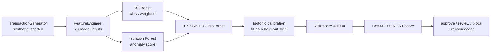
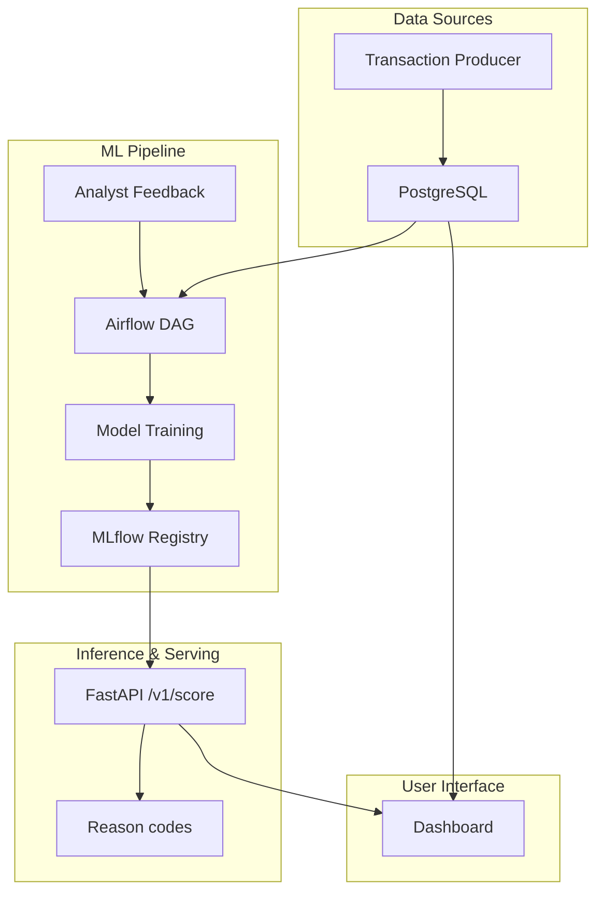

# Moniguard: fraud scoring for Nigerian pay-on-delivery e-commerce

Moniguard gives each pay-on-delivery order a fraud risk score from 0 to 1000, a decision
(approve, review or block) and the features that drove the score. It is my own product, built
end to end: synthetic data generator, feature pipeline, XGBoost + Isolation Forest ensemble,
FastAPI scoring service, analyst dashboard, and a Docker Compose stack with Airflow, MLflow,
Postgres, Prometheus and Grafana.

[](https://github.com/ikebude/mlops-fraud-detection/actions/workflows/ci.yml)
[](https://python.org)
[](LICENSE)

Designed and built by **Precious Chidiebere Ikebude** ([ikebude](https://github.com/ikebude)).

**At a glance (synthetic data only, see [Results](#results)):**

| | |
|---|---|
| Data | 60,000 synthetic transactions over 180 days, 2.8% fraud, six injected fraud patterns |
| Split | time-based: train on the first 70% of the period, test on the last 30% |
| Test PR-AUC | **0.959** (95% CI 0.942–0.972), batch features |
| Test PR-AUC through the live API path | **0.837** on 3,000 transactions scored one at a time |
| Recall if analysts review the top 5% | 0.994 |
| Reproduce | `make demo` (no Docker, no database); CI retrains twice and fails if the numbers differ |

## Problem

Nigerian pay-on-delivery (PoD) e-commerce carries fraud patterns that differ from card-present
fraud elsewhere: phone-number recycling, delivery-address clustering, account takeovers on a
new device right before a high-value order, and "friendly fraud" (a successful order followed
by a refund request). A merchant needs a score per transaction they can act on before the
rider leaves, not a monthly report.

## Data

**A synthetic generator, not a public benchmark.** `producer/main.py`'s `TransactionGenerator`
creates Nigerian e-commerce transactions (500 users, 300 devices, 50 vendors, Nigerian cities,
NGN pricing by category) with six labelled fraud patterns injected at a ~2.8% base rate
(`card_fraud`, `account_takeover`, `refund_abuse`, `identity_theft`, `triangulation`,
`friendly_fraud`). `scripts/offline_train_demo.py` spreads the transactions over a 180-day window
ending on a fixed date, so a real time-based split is possible and every run is identical.

The planned public benchmarks are PaySim (mobile money) and IEEE-CIS (card-not-present), both on
Kaggle. They need a Kaggle API token, which this run did not have. **Every number below is on
synthetic data.** It shows the pipeline works and is evaluated correctly; it is not evidence of
performance on real transactions.

## Approach



- **One feature module for training and serving.** `src/utils/feature_engineering.FeatureEngineer`
  is imported by the training script and by the scoring path (`src/inference/scoring.py`). It never
  reads the label, and a test checks that.
- **Time-based split, never a random shuffle.** Shuffling fraud data lets the model see a fraud
  ring's later transactions while training. Train is the earliest 70% of the period, test the latest 30%.
- **Calibration on data the models did not train on.** The last 15% of the training period is held
  back to fit the isotonic calibrator, so a score of 700 means roughly a 70% chance of fraud on
  this data, and the ranking survives calibration.
- **Ensemble.** XGBoost carries most of the signal; Isolation Forest adds an unsupervised anomaly
  score for patterns the labels cover poorly.
- **Tried and cut:** a GraphSAGE fraud-ring model and a Flink feature stream. Both need
  infrastructure this project does not run; simple shared-device/IP/phone counts
  (`fraud_ring_score`, `shared_ip_count`, `shared_phone_number_count`) carry the same signal here.

## Results

From `reports/metrics.json`, written by `scripts/offline_train_demo.py --n-transactions 60000 --days 180 --seed 42`
(`make demo`). With the versions in `constraints-demo.txt`, a rerun gives the same numbers; only
the latency figures depend on the machine.

| Metric (test set: 18,000 transactions, 2.9% fraud) | Value | 95% CI |
|---|---|---|
| PR-AUC | **0.959** | 0.942 – 0.972 |
| ROC-AUC | **0.996** | 0.992 – 0.999 |
| Recall if the top 1% of scores are reviewed | 0.339 (the most possible is 0.345) | — |
| Recall if the top 5% are reviewed | 0.994 | — |
| Review threshold (score ≥ 300): alert rate / precision / recall | 2.7% / 0.956 / 0.881 | — |
| Block threshold (score ≥ 700): alert rate / precision / recall | 2.5% / 0.982 / 0.837 | — |
| p95 model latency, one transaction, features precomputed | 61 ms | — |

**The live API path.** `/v1/score` receives one transaction and has no history store, so per-user,
per-device and per-IP aggregates are computed over that single row. Scoring 3,000 test transactions
(83 frauds) that way, through the same `FraudScorer` the API uses, gives **PR-AUC 0.837**,
ROC-AUC 0.921 and recall@5% 0.843, with p95 end-to-end latency 145 ms. The gap from the
batch figures is the cost of serving without a feature store; closing it is the first item below.

**Read honestly.** Fraud is 2.9% of the test set, so reviewing the top 1% of scores can
catch at most 0.345 of it; 0.339 is close to that ceiling. These numbers describe how well
the model separates this generator's six patterns from its normal traffic. The generator was
written by me, so it is easier than real fraud, and the figures say nothing about patterns it does
not produce.

## What I'd do next

1. Serve from a feature store (or a Redis lookup of each user's, device's and IP's recent history)
   so `/v1/score` sees the same aggregates as training, and compute those aggregates point-in-time.
2. Re-run on PaySim and IEEE-CIS for a public-benchmark number.
3. Set the review and block thresholds from the cost of a missed fraud versus an analyst review,
   not fixed at 300 and 700.
4. Replace the importance-weighted reason codes with SHAP TreeExplainer values.
5. Wire the Airflow DAG in `src/dags/` to this pipeline: retrain when 500+ new labels arrive, with a
   PSI drift check.
6. Fairness slices by channel and region once a real dataset exists.

## How to run

**Fast path (no Docker, no database) — retrains the model and re-measures the numbers above:**
```bash
pip install -r requirements-demo.txt -c constraints-demo.txt   # exact versions the numbers were produced with
python3 scripts/offline_train_demo.py --n-transactions 60000 --days 180 --seed 42   # overwrites reports/metrics.json and the model
MONIGUARD_API_KEYS=dev-key uvicorn src.inference.score_api:app --reload --port 8000   # serves POST /v1/score
```
or simply `make demo` (which creates `.venv`). The API refuses every request (503) when no key is configured.
The committed `moniguard/models/offline_demo/` artifacts are the output of that same command, so `/v1/score`
also works straight after a clone, without retraining.

**Tests** (feature engineering + ensemble scoring + FastAPI contract, plus dashboard auth;
**99% line coverage** of `src/utils/feature_engineering.py`, `src/inference/scoring.py` and
`src/inference/score_api.py`, the modules CI measures; Moniguard dashboard auth is covered by
`tests/test_moniguard_auth.py` but not included in that figure):
```bash
make test-unit
```

**Full production-shaped stack** (producer → Postgres → Airflow → MLflow → inference → dashboard —
see architecture diagram further below): `make build && make up && make init-db`. This needs
Docker and is meant for an Always-Free-tier VM, not CI.

## Configuration and secrets

No credentials are committed. Copy the template and fill it in before starting the stack:

```bash
cp src/.env.example src/.env
scripts/generate_fernet_key.sh        # prints a value for AIRFLOW__CORE__FERNET_KEY
```

`docker compose` refuses to start until `AIRFLOW__CORE__FERNET_KEY` is set in `src/.env`. Replace every
`change-me` value with your own secret. `.env.example` (repo root) and `src/.env.example` list every variable
the stack reads.

**Defaults that must be rotated.** These credentials were committed to this repository earlier (names only,
never values). If you ever ran the stack with them, change all of them:

| Credential | Where it is configured |
|---|---|
| Airflow web user and password | `_AIRFLOW_WWW_USER_USERNAME`, `_AIRFLOW_WWW_USER_PASSWORD` |
| Postgres `airflow` user | `POSTGRES_USER`, `POSTGRES_PASSWORD` |
| Transactions DB producer and training passwords | `POSTGRES_TRANSACTIONS_PASSWORD`, `DB_PASSWORD`, `TRAINING_DB_PASSWORD` |
| MLflow DB password | `MLFLOW_DB_PASSWORD` |
| MinIO root user and password, S3 access keys | `MINIO_USERNAME`, `MINIO_PASSWORD`, `AWS_ACCESS_KEY_ID`, `AWS_SECRET_ACCESS_KEY` |
| Airflow Fernet key | `AIRFLOW__CORE__FERNET_KEY` |
| Grafana admin password (compose default was `admin`) | `GRAFANA_PASSWORD` |
| Flask session secret (old built-in default) | `SECRET_KEY` |

These values remain in git history and must be treated as public.

**Dashboard login.** The dashboard has four fixed accounts (Admin, Exec, Ops and Analyst User). Each is enabled only
when its `MONIGUARD_*_PASSWORD` variable is set in `src/.env`; the value is a plaintext password or a hash. The
role is fixed per account, and there is no self-service password reset. After 5 failed logins for one account from
one client IP within 15 minutes, further attempts get HTTP 429 until the window passes. To set or change a password, generate a
hash, put it in `src/.env`, and restart the dashboard:

```bash
SECRET_KEY=<at least 32 random characters> flask --app moniguard/app.py hash-password
docker compose restart Moniguard
```

A hash contains `$` characters, so wrap it in single quotes in `.env`
(`MONIGUARD_ADMIN_PASSWORD='scrypt:32768:8:1$...'`). Without quotes, Compose treats `$...` as a variable and
corrupts the hash (checked with `docker compose config`).

## API

`POST /v1/score` — `{"transaction": {...}}` → `{score: 0-1000, probability, decision, reasons[],
model_version, latency_ms}`. `POST /v1/labels` — `{"transaction_id", "is_fraud"}`, logged for the
retrain DAG to pick up. Both require an `X-API-Key` header (see `MONIGUARD_API_KEYS` env var); there is no default key.
Generate keys with `python -c "import secrets; print(secrets.token_urlsafe(32))"`. A 64-character hex entry is read as
a sha256 digest of the key, not as the key itself.

---

## Full infrastructure reference (production-shaped stack)

The sections below describe the full docker-compose stack (producer, Postgres, Airflow,
MLflow, Redis, the analyst dashboard) and predate the write-up above — they're accurate to the
code in `src/`, `producer/`, and `moniguard/`, kept here as infrastructure reference. The
**Results** section above, not this one, is where the measured model numbers live.

### Access (once the stack is running)

| Service | URL | Credentials |
|---------|-----|-------------|
| Moniguard Dashboard | http://localhost:5000 | `MONIGUARD_*_PASSWORD` in `src/.env` |
| Airflow | http://localhost:8080 | set in `src/.env` |
| MLflow | http://localhost:5500 (this host only) | none; reach it remotely through an SSH tunnel |
| MinIO | http://localhost:9001 | set in `src/.env` |
| Inference API (legacy Flask) | http://localhost:8000 (this host only) | `X-API-Key` header, a key from `MONIGUARD_API_KEYS` |

Services without their own login (MLflow, the legacy inference API, Prometheus, Flower, the
exporters, the producer) and Postgres publish their ports on 127.0.0.1 only. From another machine,
use an SSH tunnel, for example `ssh -L 5500:localhost:5500 user@vm`.

### Architecture (full stack)


