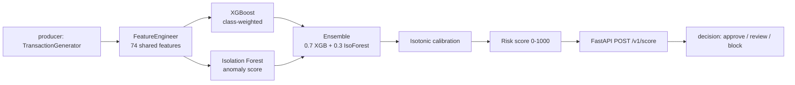
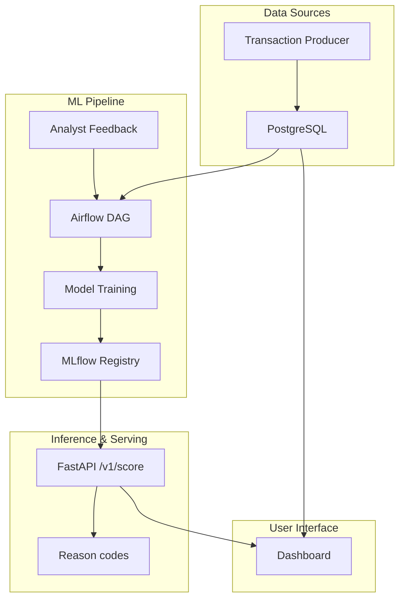

# Moniguard: fraud detection for Nigerian e-commerce

> Scores pay-on-delivery transactions 0–1000 for fraud risk. On this repo's own synthetic
> transaction generator, the ensemble reaches **PR-AUC 0.877** (95% CI 0.845–0.905) on a
> time-based held-out test set — see [Results](#results) for exactly how that number was
> produced and what it does and doesn't tell you.

[](https://github.com/ikebude/mlops-fraud-detection/actions/workflows/ci.yml)
[](https://python.org)
[](LICENSE)

Built by **Precious Ikebude** ([ikebude](https://github.com/ikebude)) as a personal product —
not a 3Consulting deliverable. See [Provenance](#provenance) below.

## Provenance

Moniguard's pipeline architecture (producer → raw transactions → a single shared
`FeatureEngineer` → XGBoost/Isolation Forest ensemble → FastAPI scoring → Airflow
retraining) is the same shape used in 3Consulting's FraudGuard product, which I worked on.
Reusing this architecture for my own personal product has been confirmed as OK with
3Consulting. Nothing here is a verbatim copy of FraudGuard's client-specific code or data —
the generator, feature set, model code, and API in this repo are Moniguard's own, written for
this project.

## Problem

Nigerian pay-on-delivery (PoD) e-commerce carries fraud patterns that differ from card-present
fraud elsewhere: phone-number recycling, delivery-address clustering, account takeovers on a
new device right before a high-value order, and "friendly fraud" (a successful order followed
by a refund request). A merchant needs a score per transaction they can act on in real time —
not a monthly report.

## Data

**Primary (current demo): a synthetic generator, not a public benchmark.** `producer/main.py`'s
`TransactionGenerator` creates realistic Nigerian e-commerce transactions (500 users, 300
devices, 50 vendors, Nigerian cities, NGN pricing by category) with six labelled fraud
patterns injected at a ~2.8% base rate (`card_fraud`, `account_takeover`, `refund_abuse`,
`identity_theft`, `triangulation`, `friendly_fraud` — see the generator for exactly how each
pattern is constructed). `scripts/offline_train_demo.py` spreads these over a configurable
historical window (180 days by default) so a genuine time-based split is possible.

**Why not PaySim or IEEE-CIS yet:** the approved spec (`PRODUCT_SPECS.md`) calls for the public
PaySim mobile-money dataset and/or the IEEE-CIS Fraud Detection dataset (both on Kaggle) as the
primary benchmark. Pulling either requires a Kaggle API token, which wasn't available when this
run was produced. **The metrics below are measured on synthetic data only** — real, reproducible,
and honestly labelled as such, but not evidence of performance on real transaction data or a
public benchmark. Swapping in PaySim/IEEE-CIS once a token is available is the top item in
[What I'd do next](#what-id-do-next).

## Approach



- **One feature source of truth**: `src/utils/feature_engineering.FeatureEngineer` is imported
  by both the offline training script and the live scoring path (`src/inference/scoring.py`) —
  the same 74 features, computed the same way, so training/serving skew isn't a silent risk.
- **Time-based split, never a random shuffle.** Random-shuffling fraud data leaks
  near-future information (a fraud ring active this week looks "normal" if some of its
  transactions are in the training set) — training uses the earliest 70% of the simulated
  period, testing uses the latest 30%.
- **Ensemble, not a single model.** XGBoost (class-weighted for the ~2.7% fraud rate) carries
  most of the signal; Isolation Forest adds an unsupervised anomaly signal that catches patterns
  the labelled classes didn't fully cover; isotonic calibration turns the blended score into a
  risk score where 0–1000 is meaningfully ordered, not just rank-ordered.
- **What I tried and didn't ship**: a GraphSAGE fraud-ring model and a Flink real-time feature
  stream were in an earlier draft of this repo's docs. Both were cut for this version — they
  need infrastructure (Spark/Flink cluster, a graph DB) this personal project doesn't run, and
  the simpler shared-device/IP graph feature in `FeatureEngineer` (`fraud_ring_score`,
  `shared_ip_count`, `shared_phone_number_count`) already captures the same signal at a
  fraction of the operational cost. Full graph neural net fraud-ring detection is a "what's
  next," not a "already built."

## Results

Real numbers from `reports/metrics.json`, produced by running `scripts/offline_train_demo.py`
(60,000 synthetic transactions over a 180-day simulated period; reproduce with `make demo`):

| Metric | Value | 95% CI |
|---|---|---|
| PR-AUC (test) | **0.877** | 0.845 – 0.905 |
| ROC-AUC (test) | **0.943** | 0.927 – 0.958 |
| Recall @ 1% alert rate | **0.377** | — |
| Recall @ 5% alert rate | **0.892** | — |
| p95 scoring latency (single transaction, FastAPI path) | **47.9 ms** | — |

Train set: 42,000 transactions (2.68% fraud). Test set: 18,000 transactions from the later
30% of the simulated period (2.62% fraud) — the model never saw these during training, and the
split respects time order.

**Read honestly:** recall@1% of 0.38 means that if an analyst team can only review the top 1%
highest-scored transactions, they'd catch about 38% of fraud at that alert volume — recall@5%
(0.89) is the more realistic operating point for a team with more review capacity. These numbers
describe how well the ensemble separates this generator's six fraud patterns from its normal
transactions — not how it would perform on fraud patterns it wasn't designed to produce.

## What I'd do next

1. Get a Kaggle API token and re-run against PaySim and/or IEEE-CIS for a real public-benchmark
   number, per the original spec — this is the most important gap above.
2. Replace the feature-importance-weighted reason codes in `/v1/score` with real SHAP
   TreeExplainer values (noted as the honest interim choice in `src/inference/scoring.py`).
3. Wire the Airflow DAG in `src/dags/` to retrain on this pipeline with the
   skip-if-fewer-than-500-new-labels rule from the spec, and add a PSI drift check.
4. Add the industry-pack idea from the FraudGuard spec, scoped down to e-commerce and mobile
   money only, per `PORTFOLIO_BUILD_PLAN.md` Workstream B item 8.
5. Fairness slices by channel/region once there's a real dataset to slice (synthetic data's
   "regions" are just Nigerian city labels with no demographic signal attached).

## How to run

**Fast path (no Docker, no database) — reproduces the numbers above:**
```bash
pip install -r requirements-demo.txt
python3 scripts/offline_train_demo.py        # writes reports/metrics.json, trains the model
uvicorn src.inference.score_api:app --reload --port 8000   # serves POST /v1/score
```
or simply `make demo`.

**Tests** (feature engineering + ensemble scoring + FastAPI contract, 97% line coverage on the
modules they target):
```bash
make test-unit
```

**Full production-shaped stack** (producer → Kafka → Postgres → Airflow → MLflow → dashboard —
see architecture diagram further below): `make build && make up && make init-db`. This needs
Docker and is meant for an Always-Free-tier VM, not CI.

## Configuration and secrets

No credentials are committed. Copy the template and fill it in before starting the stack:

```bash
cp src/.env.example src/.env
scripts/generate_fernet_key.sh        # prints a value for AIRFLOW__CORE__FERNET_KEY
```

`docker compose` refuses to start until `AIRFLOW__CORE__FERNET_KEY` is set in `src/.env`. Replace every
`change-me` value with your own secret. `.env.example` (repo root) and `src/.env.example` list every variable
the stack reads.

**Defaults that must be rotated.** These credentials were committed to this repository earlier (names only,
never values). If you ever ran the stack with them, change all of them:

| Credential | Where it is configured |
|---|---|
| Airflow web user and password | `_AIRFLOW_WWW_USER_USERNAME`, `_AIRFLOW_WWW_USER_PASSWORD` |
| Postgres `airflow` user | `POSTGRES_USER`, `POSTGRES_PASSWORD` |
| Transactions DB producer and training passwords | `POSTGRES_TRANSACTIONS_PASSWORD`, `DB_PASSWORD`, `TRAINING_DB_PASSWORD` |
| MLflow DB password | `MLFLOW_DB_PASSWORD` |
| MinIO root user and password, S3 access keys | `MINIO_USERNAME`, `MINIO_PASSWORD`, `AWS_ACCESS_KEY_ID`, `AWS_SECRET_ACCESS_KEY` |
| Airflow Fernet key | `AIRFLOW__CORE__FERNET_KEY` |
| Grafana admin password (compose default was `admin`) | `GRAFANA_PASSWORD` |
| Flask session secret (old built-in default) | `SECRET_KEY` |

These values remain in git history and must be treated as public.

**Dashboard login.** The dashboard has four fixed accounts (Admin, Exec, Ops and Analyst User). Each is enabled only
when its `MONIGUARD_*_PASSWORD` variable is set in `src/.env`; the value is a plaintext password or a hash. The
role is fixed per account, and there is no self-service password reset. To set or change a password, generate a
hash, put it in `src/.env`, and restart the dashboard:

```bash
SECRET_KEY=<at least 32 random characters> flask --app moniguard/app.py hash-password
docker compose restart Moniguard
```

A hash contains `$` characters, so wrap it in single quotes in `.env`
(`MONIGUARD_ADMIN_PASSWORD='scrypt:32768:8:1$...'`). Without quotes, Compose treats `$...` as a variable and
corrupts the hash (checked with `docker compose config`).

## API

`POST /v1/score` — `{"transaction": {...}}` → `{score: 0-1000, probability, decision, reasons[],
model_version, latency_ms}`. `POST /v1/labels` — `{"transaction_id", "is_fraud"}`, logged for the
retrain DAG to pick up. Both require an `X-API-Key` header (see `MONIGUARD_API_KEYS` env var).

---

## Full infrastructure reference (production-shaped stack)

The sections below describe the full docker-compose stack (producer, Kafka, Postgres, Airflow,
MLflow, Redis, the analyst dashboard) and predate the write-up above — they're accurate to the
code in `src/`, `producer/`, and `moniguard/`, kept here as infrastructure reference. The
**Results** section above, not this one, is where the measured model numbers live.

### Access (once the stack is running)

| Service | URL | Credentials |
|---------|-----|-------------|
| Moniguard Dashboard | http://localhost:5000 | `MONIGUARD_*_PASSWORD` in `src/.env` |
| Airflow | http://localhost:8080 | set in `src/.env` |
| MLflow | http://localhost:5500 | — |
| MinIO | http://localhost:9001 | set in `src/.env` |
| Inference API (legacy Flask) | http://localhost:8000 | — |

### Architecture (full stack)


