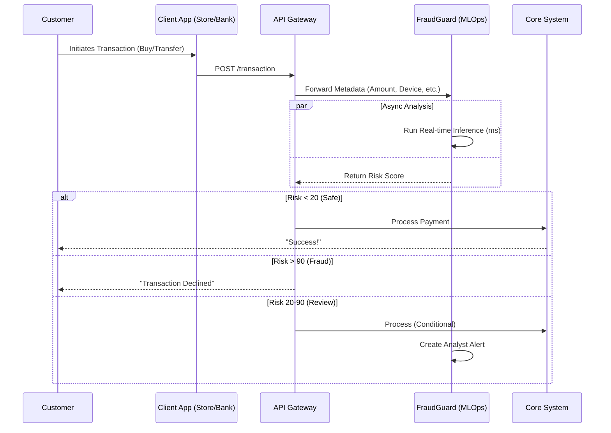

# Real-World Integration Guide: FraudGuard in Production

This guide explains how **FraudGuard** integrates into enterprise ecosystems, specifically detailing the workflows for **E-commerce** and **Fintech/Banking** environments.

---

## 1. System Architecture Overview

In a production setting, FraudGuard acts as a generic **Middleware Decision Engine**. It sits between your customer-facing applications (Mobile App, Website) and your core processing systems (Payment Gateway, Core Banking).



---

## 2. E-Commerce Integration Scenario

In a high-volume online store (e.g., Shopify, Magento, Custom), speed is critical. FraudGuard protects against **Chargebacks** and **Friendly Fraud**.

### A. The "Checkout" Handshake
1.  **Trigger**: Customer clicks "Place Order".
2.  **Data Payload**: The store sends a JSON payload to FraudGuard:
    ```json
    {
      "amount": 299.99,
      "product_category": "electronics",
      "shipping_address": "123 Main St, NY",
      "billing_address": "456 Oak Dr, CA",  // Mismatch!
      "device_fingerprint": "xyz-123",
      "ip_address": "192.168.1.5"
    }
    ```
3.  **Variable Response**:
    *   **Green (Score < 30)**: Order auto-approved. Warehouse notified.
    *   **Red (Score > 85)**: "Payment Failed" shown to user. Order cancelled.
    *   **Yellow (Score 30-85)**: Order placed in "Hold" status. Operations team alerted in `Ops Dashboard`.

### B. Post-Decision Action
When an analyst clicks **"Mark as Fraud"** in the dashboard:
*   FraudGuard sends a webhook to the E-commerce platform: `POST /store/orders/cancel { "order_id": "123" }`
*   FraudGuard adds the User ID to a global "Blacklist".

---

## 3. Fintech / Banking Integration Scenario

In banking, the focus is on **Account Takeover (ATO)** and **Money Laundering (AML)**.

### A. The "Transfer" Handshake
1.  **Trigger**: User initiates a wire transfer of $5,000.
2.  **Context**: The bank sends transaction context + historical profile:
    ```json
    {
      "user_id": "U998",
      "amount": 5000.00,
      "avg_transfer": 200.00,  // Anomaly!
      "recipient_country": "Anonymous Proxy",
      "login_time": "03:00 AM"
    }
    ```
3.  **Latency Constraints**: Banking apps allow ~500ms for checks. FraudGuard's model inference runs in <50ms.

### B. Automated Interventions
*   **Step-Up Auth**: If Risk is Medium (40-70), the Bank App asks for "Face ID" or "OTP" again.
*   **Freeze**: If Risk is Critical (90+), the account is temporarily locked.

### C. The "Simulation Log"
In your FraudGuard Admin Dashboard, you can see these "Outbound Actions" taking place. 
*   **Action**: Analyst clicks "Block" on Case #4492.
*   **Log Entry**: 
    > `[CORE_BANKING] POST /v1/cards/block - Payload: { card_id: '...4492' } - 200 OK`

This proves that FraudGuard is not an island; it drives the entire security ecosystem.

---

## 4. Technical Integration Guide (How to connect)

### API Endpoints
*   **Ingest**: `POST /api/stream/ingest` (For high-throughput Kafka streams)
*   **Predict**: `POST /api/inference/predict` (For individual REST calls)
*   **Result**: Returns `probability` (0.00-1.00) and `explanation` (shap values).

### Webhooks
Configure webhooks in `Settings` to let FraudGuard notify your system of status changes:
*   `on_alert_created`: URL to hit when a new case is opened.
*   `on_decision_made`: URL to hit when an analyst resolves a case.

---

**Summary**: FraudGuard provides the "Intelligence Layer". Your existing systems provide the "Action Layer". Together, they form a closed-loop security perimeter.
